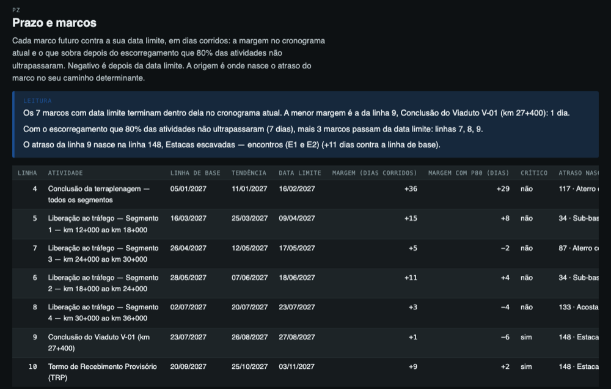
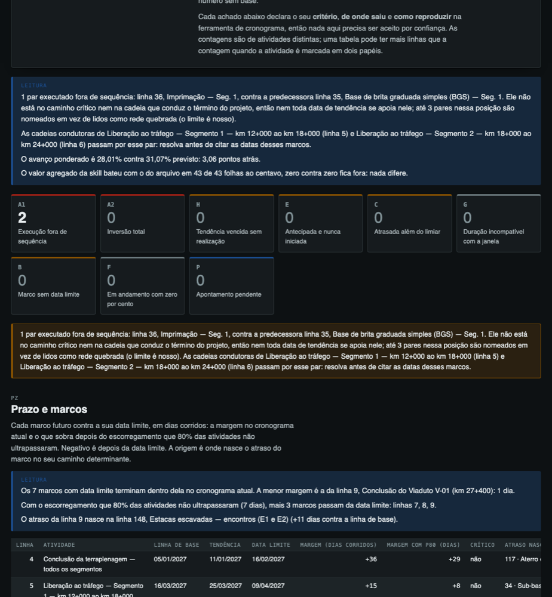
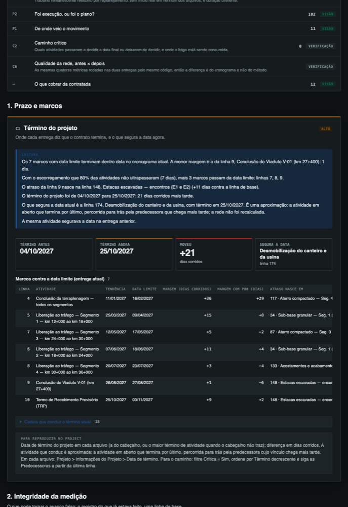
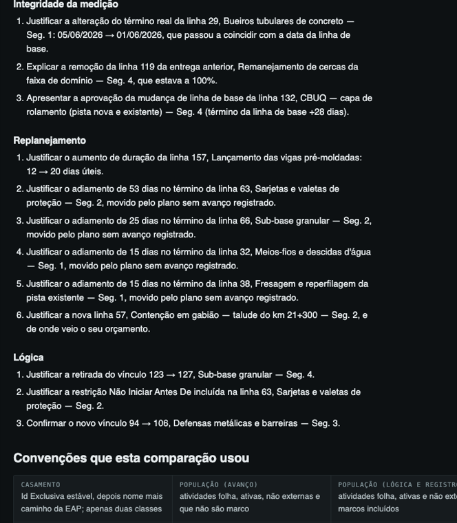
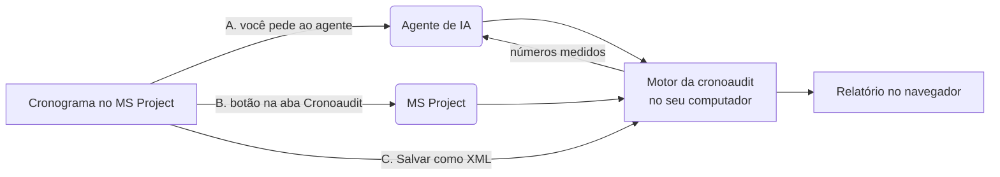

# cronoaudit

[English](README.md)


**A cronoaudit revisa cronogramas de obras e de infraestrutura e diz o que merece atenção.** Ela
procura as falhas que produzem um número errado com cara de certo, e não uma mensagem de erro:
- um marco a um dia da data limite;
- uma data real reescrita depois do fato;
- uma atividade com avanço que sumiu de uma revisão para a outra;
- uma atividade que começou antes de a predecessora terminar.

Você usa do jeito que preferir: conversando com um agente de IA, clicando num botão dentro do MS
Project, ou rodando sem IA nenhuma.



## Por que usar

| | |
|---|---|
| **29 segundos** | para analisar um cronograma real de 6.484 tarefas e 107 calendários, num notebook comum (Apple M1, medido em 22/11/2026). |
| **Ao centavo** | o valor agregado da cronoaudit é conferido, atividade por atividade, com o que o próprio MS Project calculou. Quando não bate, o relatório diz onde. |
| **14 de 14** | problemas plantados no exemplo fictício aparecem no relatório. A lista do que foi plantado está em [`examples/`](examples/LEIA-ME.md), e um teste automático confere a cada versão. |
| **12 cobranças prontas** | na comparação entre duas revisões do exemplo, uma por evidência, a integridade da medição primeiro. |
| **Nada inventado** | os números saem do motor, não do agente. Cada afirmação vem marcada como medida, inferida ou relatada. |

## O que você recebe

Um relatório que abre no navegador, no idioma do cronograma. Cada seção começa com uma leitura
curta, escrita por regras.

**Uma revisão:** o prazo primeiro (cada marco contra a data limite, com a margem e onde nasce o
atraso); nove verificações de integridade; a curva S com os dados do próprio arquivo;
produtividade por recurso; catorze métricas de qualidade da rede; Earned Schedule e as próximas
semanas; a forense de onde entrou o atraso de cada marco.



**Duas revisões comparadas, na ordem em que se lê:** 1. prazo; 2. se a medição é confiável;
3. o que o plano mudou; 4. avanço; 5. folga e caminho crítico; 6. qualidade da rede; e, no fim,
**o que cobrar da contratada**.

<p>


</p>

## Escolha como usar

| Você prefere | Caminho | O que você faz |
|---|---|---|
| Conversar com uma IA e deixar ela fazer tudo | **A. Pelo agente** | *"analise o Rev04.mpp"* |
| Um botão, dentro do próprio Project | **B. Pela aba Cronoaudit** | clica em **Relatório** ou **Analisar** |
| Sem IA, ou num computador sem agente | **C. Pelo motor** | um comando, sobre o XML exportado |



Nos três, o motor roda no seu computador e não envia nada. O que muda é quem conversa com você.

### A. Pelo agente

Para quem gosta de pedir e deixar fazer. No Windows com o MS Project instalado, você não precisa
exportar nada: o agente passa o `.mpp` para a cronoaudit, que pede ao próprio Project para
exportar o arquivo e segue a análise. O arquivo é aberto só para leitura e não muda. Se ele já
estiver aberto no Project, a sua janela não é tocada: a cronoaudit lê a versão salva em disco.

Exemplos do que dizer:
- *Analise o Rev04.mpp.*
- *Compare o Rev03.mpp com o Rev04.mpp e me diga o que mudou.*
- *Analise o cronograma que está aberto no Project.*
- *Quais marcos correm risco de passar da data limite?*
- *Escreva a síntese e gere o relatório final.*

Use o agente de sua preferência, ou o que a sua empresa permite no seu computador. Este guia
mostra quatro: Claude Code, GitHub Copilot, Codex (OpenAI) e Grok Build (xAI). Como instalar está
em [Instalar](#instalar).

**Como é uma conversa** (teste com a rodovia fictícia, em 22/11/2026):

> **Você:** Compare a rev03 com a rev04 e me diga o que mudou, por assunto.
>
> **Agente:** O término do projeto foi de 04/10/2027 para 25/10/2027, 21 dias depois. Antes do
> avanço, três pontos pedem resposta da contratada: o término real da linha 29 foi reescrito e
> passou a coincidir com a data da linha de base; a linha 119, a 100%, foi removida e levou o
> valor agregado junto; e a linha de base da linha 132 mudou. O atraso do marco do viaduto nasce
> na linha 148 e cresce na linha 157, cuja duração passou de 12 para 20 dias…

### B. Pela aba Cronoaudit, dentro do Project (Windows)

Para quem prefere um botão. A aba fica entre **Projeto** e **Exibir**:

| Grupo | Botão | O que faz |
|---|---|---|
| Com o agente de IA | **Analisar** | abre o seu agente já com o cronograma aberto |
| | **Comparar versões** | mostra as outras versões da mesma pasta e abre o agente com as duas |
| Sem IA | **Relatório** | gera o relatório e abre no navegador; nada sai do computador |
| | **Comparar** | o mesmo, para duas versões |
| | **Exportar XML** | só exporta, para levar a outro lugar |
| Ajustes | **Configurar** | agente, pasta dos relatórios, modo |

Os botões nunca perguntam se é para salvar o seu arquivo: eles leem a versão salva em disco.

Para instalar a aba, com o Project fechado, no PowerShell:

```
irm https://raw.githubusercontent.com/Holiv/cronoaudit/main/msproject/install-msproject.ps1 | iex
```

Durante a instalação o Project abre e pede duas coisas, que são suas:
1. se aparecer a janela de **Logon** com perfis, escolha **Computador**;
2. no aviso sobre macros do modelo, clique em **Desabilitar macros**.

O instalador guarda uma cópia do que muda antes de mudar, não altera nenhuma configuração de
segurança e confere no fim que os botões respondem. Para remover, defina
`$env:CRONOAUDIT_MSPROJECT_REMOVE="1"` na mesma janela e rode o mesmo comando. Pelo botão, o modo
secreto é uma escolha na hora de abrir o agente: o botão roda a cópia codificada e abre o agente nela.
Mais detalhes em [`msproject/`](msproject/LEIA-ME.md).

### C. Pelo motor, sem agente

Para quando não há agente no computador, ou quando a política da empresa não permite usar um.
Mesmo relatório, sem conversa, e nada sai do computador.

1. No MS Project: **Arquivo → Salvar como → Formato XML (\*.xml)**. É o formato do próprio
   Project; nada do que a cronoaudit precisa se perde.
2. No PowerShell:

```
python "$env:USERPROFILE\.claude\skills\cronoaudit\scripts\review.py" "C:\caminho\do\cronograma.xml"
```

Dois arquivos, o anterior primeiro, geram a comparação. No Windows com o Project, o comando
também aceita o `.mpp` direto. Se a análise com agente for feita em outro computador, que seja um
computador autorizado pela empresa a receber o cronograma.

## Instalar

### Como abrir o PowerShell (Windows)

1. Aperte a tecla Windows.
2. Digite `PowerShell`.
3. Clique em **Windows PowerShell**.

Abre uma janela com um cursor piscando. Cole o comando com o botão direito do mouse e aperte
Enter. Use essa janela, não o "Prompt de Comando" (cmd). No macOS, abra o **Terminal**.

### 1. A cronoaudit (sempre)

Um comando instala para todos os agentes de uma vez e para o uso sem agente.

**Windows (PowerShell):**

```
irm https://raw.githubusercontent.com/Holiv/cronoaudit/main/install.ps1 | iex
```

**macOS / Linux (Terminal):**

```
curl -fsSL https://raw.githubusercontent.com/Holiv/cronoaudit/main/install.sh | bash
```

No fim deve aparecer **`cronoaudit 0.9.2 is installed`**. A cronoaudit precisa do Python 3.9 ou
mais novo; no Windows, se não houver Python, o instalador traz uma cópia própria, sem precisar de
administrador. Para atualizar, rode o mesmo comando de novo.

### 2. Um agente (só para o caminho A, ou para o botão Analisar)

Escolha um. Comandos oficiais de cada fornecedor, em novembro de 2026. Depois de instalar, feche o
PowerShell e abra outro. Cada agente precisa de uma conta no fornecedor; confira qual plano o
inclui e a política da sua empresa.

| Agente | Windows (PowerShell) | Abrir | Guia oficial |
|---|---|---|---|
| Claude Code (Anthropic) | `irm https://claude.ai/install.ps1 \| iex` | `claude` | [code.claude.com](https://code.claude.com/docs/en/setup) |
| GitHub Copilot CLI | `winget install GitHub.Copilot` | `copilot` | [docs.github.com](https://docs.github.com/pt/copilot/how-tos/copilot-cli/set-up-copilot-cli/install-copilot-cli) |
| Codex (OpenAI) | `powershell -ExecutionPolicy ByPass -c "irm https://chatgpt.com/codex/install.ps1 \| iex"` | `codex` | [github.com/openai/codex](https://github.com/openai/codex) |
| Grok Build (xAI) | `irm https://x.ai/cli/install.ps1 \| iex` | `grok` | [docs.x.ai](https://docs.x.ai/build/overview) |

No macOS e no Linux, os guias oficiais trazem o comando de cada um. No Copilot, se ele vem da
empresa, é a empresa que decide se a CLI está habilitada.

Os quatro leem a pasta de skills que o instalador da cronoaudit criou. Para conferir, abra o
agente e pergunte *"quais skills você tem?"*. Até agora a cronoaudit foi testada de ponta a ponta
com o Claude Code; nos outros três, a instalação segue o que os fornecedores documentam.

### 3. A aba no Project (só para o caminho B)

Veja o [caminho B](#b-pela-aba-cronoaudit-dentro-do-project-windows).

## Para onde vão os seus dados

- **O motor roda no seu computador e não envia nada.** Ele não usa a rede.
- **Os instaladores baixam** este repositório do GitHub e, no Windows e só se precisar, o Python do
  python.org. Mais nada.
- **O agente é outra história.** O que ele lê (o cronograma, o relatório, as suas perguntas) vai
  para o fornecedor dele, nos termos da sua conta ou da conta da empresa. Confira a política da
  empresa antes de usar um agente com cronograma de contrato.
- **Se a política não permite agente,** use o caminho C, ou os botões "Sem IA" da aba.

### Modo secreto (experimental)

Para conversar com o agente sem que os nomes, os valores e as datas saiam do seu computador. Pela
aba do Project, responda **Sim** quando Analisar ou Comparar perguntarem o modo. Sem a aba, você
mesmo roda um comando, com o `.xml` ou, no Windows com o Project, com o `.mpp`:

```
python "$env:USERPROFILE\.claude\skills\cronoaudit\scripts\review.py" "C:\caminho\do\Rev04.mpp" --secret
```

A cronoaudit analisa o arquivo real no seu computador e grava uma cópia codificada numa pasta
separada: nomes viram códigos como `T·3fa91c`, datas viram contagens como `D+0412`, e os valores
são multiplicados por um fator secreto. Durações, percentuais e números de linha continuam reais.
Você abre o agente nessa pasta, e ele lê só a cópia. Quando você pede o relatório final, a
cronoaudit decodifica no seu computador e abre com os nomes reais.

O que ele faz e o que não faz:
- No Claude Code, a pasta traz regras que mantêm o agente dentro dela; os outros agentes recebem as
  mesmas regras como instruções escritas.
- Os códigos não tornam o cronograma anônimo: a estrutura e as durações continuam legíveis.
- Não substitui a política da sua empresa sobre serviços de IA.

Testado no Windows com o Claude Code em 22/11/2026, e num cronograma real de 6.484 tarefas:
nenhum nome, data ou valor real chegou à cópia codificada.

## Se algo der errado

| O que aparece | O que fazer |
|---|---|
| *'irm' não é reconhecido* | Você está no Prompt de Comando (cmd). Abra o PowerShell. |
| *python não é reconhecido* | Rode o instalador da cronoaudit de novo; no Windows ele traz o próprio Python. |
| O comando do agente não é encontrado | Feche o PowerShell e abra outro. |
| O agente não conhece a cronoaudit | Feche o agente e abra de novo. No Copilot, `/skills reload`. Pergunte *"quais skills você tem?"*. |
| `/cronoaudit` não faz nada | Comandos com `/` só funcionam dentro do agente, não no PowerShell. Pode só pedir com palavras. |
| *O MS Project não foi encontrado* | O `.mpp` só é lido por um computador com o Project. Use o caminho C com o XML exportado por quem tem o Project. |
| Aviso de *alterações não salvas* | É informativo: o Project marca o arquivo assim só por abrir. A análise leu a versão salva em disco. |
| A aba não aparece | Feche e abra o Project. Se continuar, rode o instalador da aba de novo. |

## Mais

- **Como funciona por dentro.** O motor lê o XML que o próprio Project exporta (MSPDI), que traz
  tarefas, vínculos, as onze linhas de base, calendários e campos personalizados. Quando você passa
  um `.mpp`, a cronoaudit pede ao Project instalado para fazer essa exportação. O processo completo,
  em inglês: [`skills/cronoaudit/references/usage.md`](skills/cronoaudit/references/usage.md).
- **Manual**, catorze capítulos: [português](docs/manual/manual-pt.pdf),
  [inglês](docs/manual/manual-en.pdf).
- **O exemplo fictício**, para experimentar primeiro: [`examples/`](examples/LEIA-ME.md). Os
  números deste guia saem dos `.xml` do exemplo; os `.mpp` dão um pouco diferente (+22 dias, 14
  cobranças), porque o Project recalculou o cronograma ao criá-los.

### Outras formas de instalar

| Caminho | Comando |
|---|---|
| Qualquer cliente de Agent Skills | `npx skills add Holiv/cronoaudit -g` |
| Claude Code, como plugin | `/plugin marketplace add Holiv/cronoaudit`, depois `/plugin install cronoaudit@cronoaudit` |
| Codex | `$skill-installer https://github.com/Holiv/cronoaudit` |
| Uma equipe, pelo projeto | `git clone https://github.com/Holiv/cronoaudit .agents/skills/cronoaudit` dentro do projeto |

Opções do instalador no Windows, definidas na mesma janela antes do comando:
`$env:CRONOAUDIT_NO_PYTHON="1"` (nunca baixar Python), `$env:CRONOAUDIT_EMBED_PYTHON="1"` (usar o
Python próprio mesmo havendo outro), `$env:CRONOAUDIT_REF="nome-da-branch"` (outra branch).

### O que ela não faz

Não lê Primavera P6. Não produz pleito contratual de atraso: a forense mostra o mecanismo, e um
pleito precisa de registros contemporâneos e de um método formal. Não certifica DCMA: as catorze
métricas são uma implementação, identificada como tal.

### Conferir a ferramenta

`python skills/cronoaudit/scripts/test_checks.py`, a partir de uma cópia deste repositório.

### Procedência

Escrita a partir de um método documentado e genérico, sem portar o código de nenhuma aplicação, e
medida num programa real de 6.484 tarefas com 107 calendários. Números de escala ficam;
identidades saem: nenhum empregador, contratada, contrato, quilometragem, pessoa ou valor aparece
neste repositório.

### Licença

Apache 2.0. © 2026 Helton da Silva de Oliveira.
