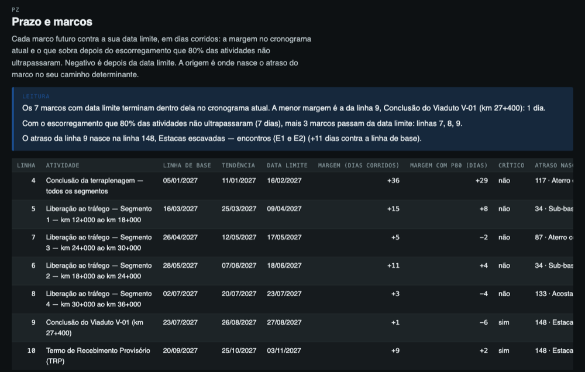
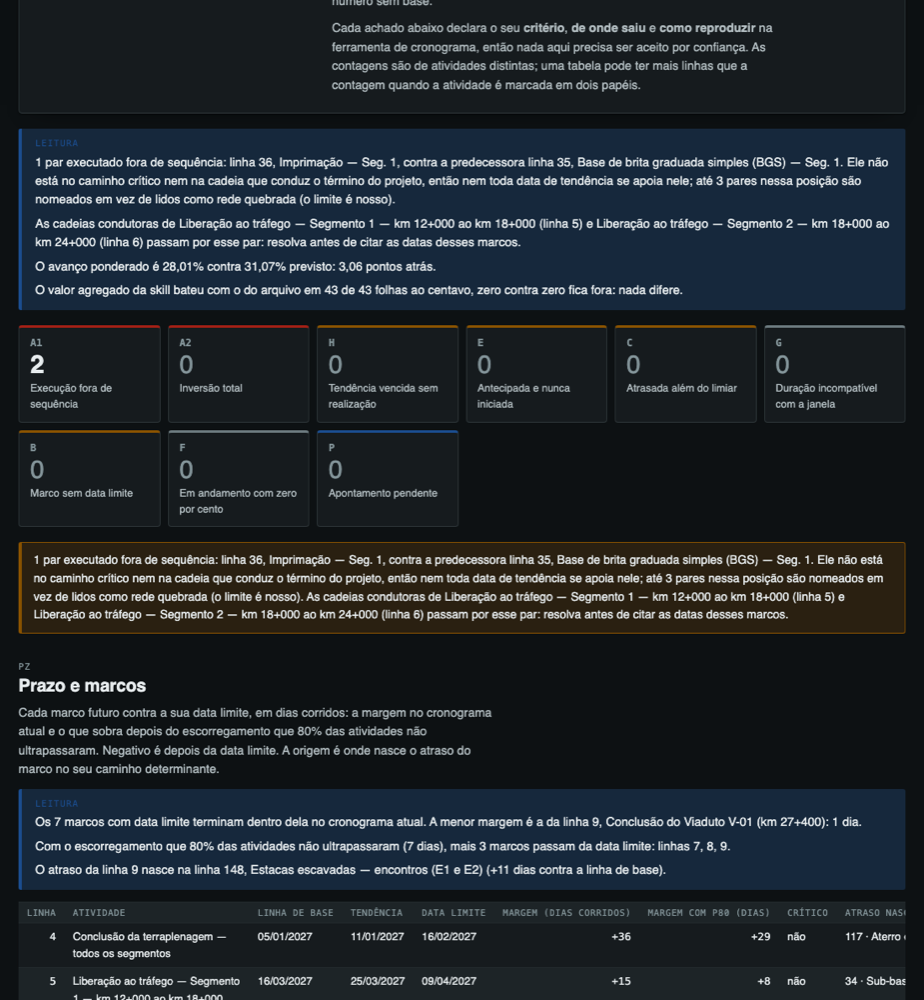
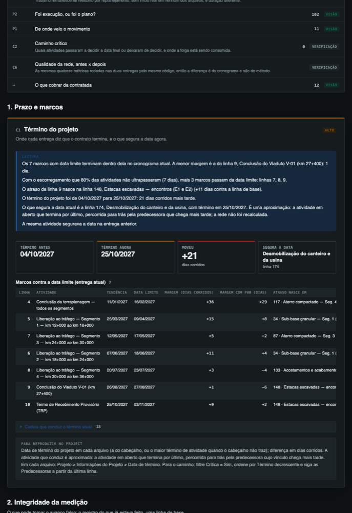
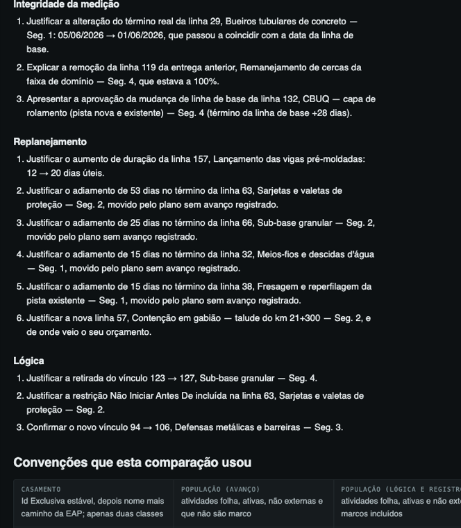
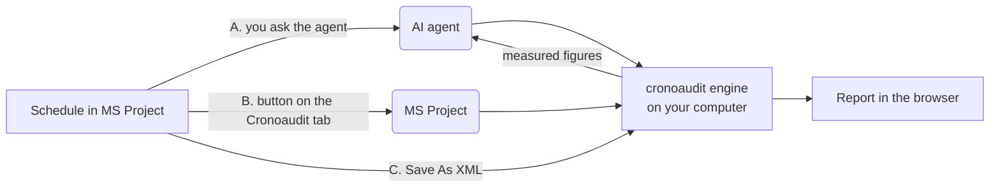

# cronoaudit

[Português](LEIA-ME.md)


**cronoaudit reviews construction and infrastructure schedules and tells you what deserves
attention.** It looks for the failures that produce a believable wrong number rather than an
error message:
- a milestone one day from its deadline;
- an actual date rewritten after the fact;
- an activity with progress that vanished from one revision to the next;
- an activity that started before its predecessor finished.

Use it the way you prefer: talking to an AI agent, clicking a button inside MS Project, or with
no AI at all.



## Why use it

| | |
|---|---|
| **29 seconds** | to analyse a real schedule of 6,484 tasks and 107 calendars, on an ordinary laptop (Apple M1, measured on 22/11/2026). |
| **To the cent** | cronoaudit's earned value is checked, activity by activity, against what MS Project itself computed. When it does not match, the report says where. |
| **14 of 14** | problems planted in the fictitious example appear in the report. The list of what was planted is in [`examples/`](examples/), and an automatic test checks it on every version. |
| **12 ready questions** | when comparing the example's two revisions, one per piece of evidence, the integrity of the measurement first. |
| **Nothing invented** | the numbers come from the engine, not from the agent. Every claim is marked measured, inferred or reported. |

## What you get

A report that opens in the browser, in the schedule's own language (the screenshots are of a
Portuguese schedule). Every section opens with a short reading written by rules.

**One revision:** deadlines first (each milestone against its deadline, with the margin and where
its delay starts); nine integrity checks; the S-curve from the file's own data; productivity by
resource; fourteen network-quality metrics; Earned Schedule and the next weeks; forensics of where
each milestone's delay entered.



**Two revisions compared, in the order you read them:** 1. deadlines; 2. whether the measurement
can be trusted; 3. what the plan changed; 4. progress; 5. float and critical path; 6. network
quality; and at the end, **what to ask the contractor**.

<p>


</p>

## Choose how to use it

| You prefer | Path | What you do |
|---|---|---|
| To talk to an AI and let it do everything | **A. Through the agent** | *"analyse Rev04.mpp"* |
| A button, inside Project itself | **B. The Cronoaudit tab** | click **Relatório** or **Analisar** |
| No AI, or a computer with no agent | **C. The engine** | one command, on the exported XML |



In all three, the engine runs on your computer and sends nothing. What changes is who talks to you.

### A. Through the agent

For those who like to ask and let it run. On Windows with MS Project installed, you do not need to
export anything: the agent hands the `.mpp` to cronoaudit, which asks Project itself to export it
and goes on with the analysis. The file is opened read-only and does not change. If it is already
open in Project, your window is not touched: cronoaudit reads the version saved on disk.

What to say, for example:
- *Analyse Rev04.mpp.*
- *Compare Rev03.mpp with Rev04.mpp and tell me what changed.*
- *Analyse the schedule open in Project.*
- *Which milestones are at risk of missing their deadline?*
- *Write the executive summary and generate the final report.*

Use the agent you prefer, or the one your company allows on your computer. This guide covers four:
Claude Code, GitHub Copilot, Codex (OpenAI) and Grok Build (xAI). See [Install](#install).

**What a conversation looks like** (a test on the fictitious road project, 22/11/2026):

> **You:** Compare rev03 and rev04 and tell me what changed, by topic.
>
> **Agent:** The project finish moved 21 days, from 04/10/2027 to 25/10/2027. Before the progress
> figure, three things need an answer from the contractor: the actual finish of row 29 was
> rewritten and now equals the baseline date; row 119, at 100%, was removed, taking its earned
> value with it; and the baseline of row 132 moved. The delay of the viaduct milestone starts at
> row 148 and grows at row 157, whose duration went from 12 to 20 days…

### B. The Cronoaudit tab, inside Project (Windows)

For those who prefer a button. The tab sits between **Project** and **View**; its labels are in
Portuguese:

| Group | Button | What it does |
|---|---|---|
| Com o agente de IA | **Analisar** | opens your agent with the schedule already loaded |
| | **Comparar versões** | lists the other versions in the same folder and opens the agent with both |
| Sem IA | **Relatório** | writes the report and opens it; nothing leaves the computer |
| | **Comparar** | the same, for two versions |
| | **Exportar XML** | only exports, to take elsewhere |
| Ajustes | **Configurar** | agent, report folder, mode |

The buttons never ask whether to save your file: they read the version saved on disk.

To install the tab, with Project closed, in PowerShell:

```
irm https://raw.githubusercontent.com/Holiv/cronoaudit/main/msproject/install-msproject.ps1 | iex
```

During the installation Project opens and asks two things, which are yours to answer:
1. if a **Logon** window with profiles appears, choose **Computer**;
2. at the warning about the template's macros, click **Disable macros**.

The installer backs up what it changes before changing it, changes no security setting, and checks
at the end that the buttons answer. To remove it, set `$env:CRONOAUDIT_MSPROJECT_REMOVE="1"` in the
same window and run the same command. From the button, secret mode is a choice when the agent
opens: the button runs the coded copy and opens the agent in it. More in [`msproject/`](msproject/).

### C. The engine, without an agent

For when there is no agent on the computer, or the company's policy does not allow one. Same report,
no conversation, and nothing leaves the computer.

1. In MS Project: **File → Save As → XML Format (\*.xml)**. That is Project's own format; nothing
   cronoaudit needs is lost.
2. In PowerShell:

```
python "$env:USERPROFILE\.claude\skills\cronoaudit\scripts\review.py" "C:\path\to\schedule.xml"
```

Two files, previous first, give the comparison. On Windows with Project, the command also takes the
`.mpp` directly. If the analysis with an agent is done on another computer, it should be one the
company allows to receive the schedule.

## Install

### How to open PowerShell (Windows)

1. Press the Windows key.
2. Type `PowerShell`.
3. Click **Windows PowerShell**.

A window with a blinking cursor opens. Paste a command with a right click and press Enter. Use this
window, not "Command Prompt" (cmd). On macOS, open **Terminal**.

### 1. cronoaudit (always)

One command installs it for every agent at once, and for use without an agent.

**Windows (PowerShell):**

```
irm https://raw.githubusercontent.com/Holiv/cronoaudit/main/install.ps1 | iex
```

**macOS / Linux (Terminal):**

```
curl -fsSL https://raw.githubusercontent.com/Holiv/cronoaudit/main/install.sh | bash
```

At the end you should see **`cronoaudit 0.9.2 is installed`**. cronoaudit needs Python 3.9 or
later; on Windows, if there is no Python, the installer brings its own copy, with no administrator
rights. To update, run the same command again.

### 2. An agent (only for path A, or for the Analisar button)

Pick one. Official commands from each provider, as of November 2026. After installing, close
PowerShell and open a new one. Each agent needs an account with its provider; check which plan
includes it and your company's policy.

| Agent | Windows (PowerShell) | Start | Official guide |
|---|---|---|---|
| Claude Code (Anthropic) | `irm https://claude.ai/install.ps1 \| iex` | `claude` | [code.claude.com](https://code.claude.com/docs/en/setup) |
| GitHub Copilot CLI | `winget install GitHub.Copilot` | `copilot` | [docs.github.com](https://docs.github.com/en/copilot/how-tos/copilot-cli/set-up-copilot-cli/install-copilot-cli) |
| Codex (OpenAI) | `powershell -ExecutionPolicy ByPass -c "irm https://chatgpt.com/codex/install.ps1 \| iex"` | `codex` | [github.com/openai/codex](https://github.com/openai/codex) |
| Grok Build (xAI) | `irm https://x.ai/cli/install.ps1 \| iex` | `grok` | [docs.x.ai](https://docs.x.ai/build/overview) |

On macOS and Linux, the official guides give each command. If your Copilot comes from your company,
the company decides whether the CLI is enabled.

All four read the skill folder the cronoaudit installer created. To check, start the agent and ask
*"what skills do you have?"*. So far cronoaudit has been tested end to end with Claude Code; for the
other three, the installation follows what the providers document.

### 3. The tab in Project (only for path B)

See [path B](#b-the-cronoaudit-tab-inside-project-windows).

## Where your data goes

- **The engine runs on your computer and sends nothing.** It never touches the network.
- **The installers download** this repository from GitHub and, on Windows only if needed, Python
  from python.org. Nothing else.
- **The agent is different.** What it reads (the schedule, the report, your questions) goes to its
  provider, under the terms of your account or your company's. Check the company's policy before
  using an agent with a contract schedule.
- **If the policy does not allow an agent,** use path C, or the tab's "Sem IA" buttons.

### Secret mode (experimental)

To talk to the agent without the names, values and dates leaving your computer. From the Project
tab, answer **Yes** when Analisar or Comparar ask for the mode. Without the tab, you run one command
yourself, with the `.xml` or, on Windows with Project, the `.mpp`:

```
python "$env:USERPROFILE\.claude\skills\cronoaudit\scripts\review.py" "C:\path\to\Rev04.mpp" --secret
```

cronoaudit analyses the real file on your computer and writes a coded copy in a separate folder:
names become codes like `T·3fa91c`, dates become day counts like `D+0412`, and money is multiplied
by a secret factor. Durations, percentages and row numbers stay real. You open the agent in that
folder, and it reads only the copy. When you ask for the final report, cronoaudit decodes it on your
computer and opens it with the real names.

What it does and does not do:
- In Claude Code, the folder carries rules that keep the agent inside it; other agents receive the
  same rules as written instructions.
- The codes do not make the schedule anonymous: its structure and durations stay readable.
- It does not replace your company's policy on AI services.

Tested on Windows with Claude Code on 22/11/2026, and on a real 6,484-task schedule: no real name,
date or value reached the coded copy.

## If something goes wrong

| What you see | What to do |
|---|---|
| *'irm' is not recognized* | You are in Command Prompt (cmd). Open PowerShell. |
| *python is not recognized* | Run the cronoaudit installer again; on Windows it brings its own Python. |
| The agent's command is not found | Close PowerShell and open a new one. |
| The agent does not know cronoaudit | Close the agent and start it again. In Copilot, `/skills reload`. Ask *"what skills do you have?"*. |
| `/cronoaudit` does nothing | Commands with `/` work only inside the agent, not in PowerShell. You can just ask in words. |
| *MS Project was not found* | A `.mpp` can only be read on a computer with Project. Use path C with the XML exported by someone who has Project. |
| A note about *unsaved changes* | It is information only: Project marks a file so just by opening it. The analysis read the version saved on disk. |
| The tab does not appear | Close and open Project. If it is still missing, run the tab installer again. |

## More

- **How it works inside.** The engine reads the XML that Project itself exports (MSPDI), which
  carries tasks, links, the eleven baselines, calendars and custom fields. When you pass a `.mpp`,
  cronoaudit asks the installed Project to do that export. The whole process:
  [`skills/cronoaudit/references/usage.md`](skills/cronoaudit/references/usage.md).
- **Manual**, fourteen chapters: [English](docs/manual/manual-en.pdf),
  [Português](docs/manual/manual-pt.pdf).
- **The fictitious example**, to try first: [`examples/`](examples/). The figures in this guide come
  from the example's `.xml` files; its `.mpp` files give slightly different ones (+22 days, 14
  questions), because Project recalculated the schedule when they were created.

### Other ways to install

| Route | Command |
|---|---|
| Any Agent Skills client | `npx skills add Holiv/cronoaudit -g` |
| Claude Code, as a plugin | `/plugin marketplace add Holiv/cronoaudit`, then `/plugin install cronoaudit@cronoaudit` |
| Codex | `$skill-installer https://github.com/Holiv/cronoaudit` |
| A team, through the project | `git clone https://github.com/Holiv/cronoaudit .agents/skills/cronoaudit` inside the project |

Installer options on Windows, set in the same window before the command:
`$env:CRONOAUDIT_NO_PYTHON="1"` (never download Python), `$env:CRONOAUDIT_EMBED_PYTHON="1"` (use the
bundled Python even if there is another), `$env:CRONOAUDIT_REF="branch-name"` (another branch).

### What it does not do

It does not read Primavera P6. It does not produce a contractual delay claim: the forensics show
the mechanism, and a claim needs contemporaneous records and a formal method. It does not certify
against DCMA: the fourteen metrics are an implementation, labelled as such.

### Check the tool

`python skills/cronoaudit/scripts/test_checks.py`, from a copy of this repository.

### Provenance

Written from a documented, generic method, not ported from any application's source, and measured
on a real 6,484-task programme with 107 calendars. Numbers of scale stay; identities go: no
employer, contractor, contract, chainage, person or value appears in this repository.

### Licence

Apache 2.0. © 2026 Helton da Silva de Oliveira.
